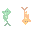

<picture>
  <source media="(prefers-reduced-motion: reduce)" srcset="https://raw.githubusercontent.com/guilhermedworakowski/guilhermedworakowski/main/assets/carps-static.svg">
  
</picture>

### Senior Product Designer | Design Engineer | UX Designer | DesignOps&nbsp;·&nbsp;Brazil

[Portfolio](https://guilhermedesignd.com) · [LinkedIn](https://linkedin.com/in/guilherme-domingues-dworakowski) · [Resume](https://drive.google.com/file/d/1ANQxkaGct5Y_V3FyhvXonGFHc9Lgl2-L/view?usp=sharing) 

---

### About

I'm a Product Designer with 4 years of experience in hosting, SaaS and loyalty programs in a regulated market.

Today I work as a design engineer. With AI and the Figma MCP, I take an idea through research, design and code to a published product, and I turn what works into workflows that can be reused. The agents speed up the building. The decisions and the final validation stay with me.

- **AI workflows:** I built an orchestrator with three specialist agents for a design team's process, now open source, and a design-to-development handoff skill that cut 2 weeks off a feature's deployment.
- **Design engineering:** I built AL Design System on my own, from the Figma components to the published npm package.
- **AI in the product:** I designed the AI-powered domain purchase flow live at Locaweb and KingHost, where the user describes their business and a language model suggests and checks domains.
- **Measured results:** my work on KingHost's domain registration raised conversion by 13% in an A/B test.

---

### Public projects

**[AL Design System](https://github.com/guilhermedworakowski/al-design-system)** · An open-source, AI Ready design system, from Figma to code. Agents don't have to guess how to use it: the package ships a component catalog, usage rules in Markdown, a markup validator and an MCP server, and the site publishes an `llms.txt`. [Documentation](https://al.guilhermedesignd.com)

**[Design Skill](https://github.com/guilhermedworakowski/design-skill)** · A Claude skill that organizes the design process into three agents: strategy, research and design engineering. An orchestrator reads each request and calls the right one. Available in English and Portuguese.
